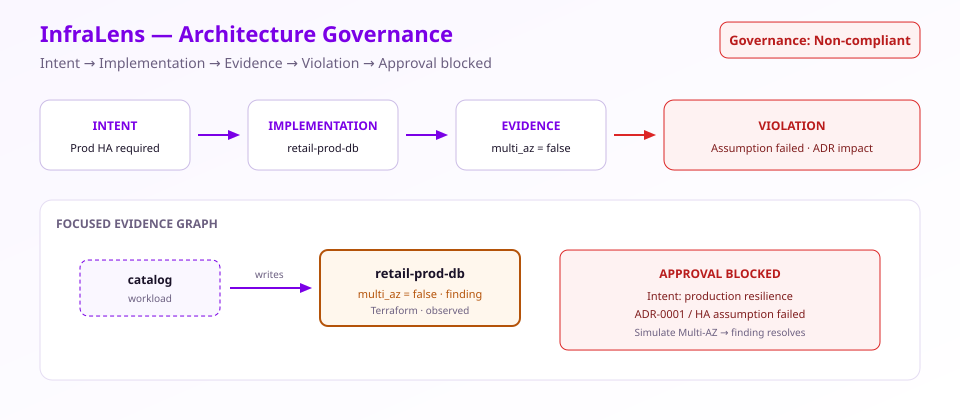

# InfraLens — Architecture Governance

> InfraLens proves whether the architecture you are running still matches the architecture you intended.

Scan infrastructure-as-code, deployment manifests and application configuration. Reconstruct the architecture, trace every conclusion to evidence, validate reality against intent, and determine whether approval remains valid.

[](https://github.com/markndg/InfraLens/actions/workflows/ci.yml)
[](LICENSE)
[](package.json)
[](CHANGELOG.md)



<p align="center"><em>Intent versus reality · Evidence behind every conclusion · Approval that invalidates when the architecture changes</em></p>

## Why InfraLens?

Infrastructure tools tell you what exists.

InfraLens tells you:

- why it exists;
- whether it still satisfies the intended architecture;
- what changed;
- which assumptions failed;
- which decisions or ADRs are invalid;
- and whether approval remains defensible.

**InfraLens does not require an LLM.** Architecture reconstruction, projections, reviews, recommendations and explanations are deterministic and evidence-backed.

## See it in 30 seconds

1. Approval is **blocked** — production resilience intent is not satisfied.
2. The failed assumption points at the database (`multi_az = false`).
3. Linked ADR / contract impact is visible in the governance console.
4. A **graph-only** simulation enabling Multi-AZ shows the finding resolve — no production change.

Full walkthrough: [docs/demo/walkthrough.md](docs/demo/walkthrough.md)

## What makes it different

| Differentiator | What you get |
|----------------|--------------|
| **Intent versus reality** | Validate intents, ADRs, assumptions and contracts against declared, rendered, planned and observed implementation. |
| **Evidence behind every conclusion** | Trace nodes, relationships, findings and approvals to exact source evidence. |
| **Approval invalidation** | Bind sign-off to a specific evidence state; invalidate it when material change occurs. |
| **One graph, many projections** | Capability, application, physical, data, ownership, security and more — each with one architectural question. |
| **Deterministic review** | Same inputs → same graph, projections and governance outcomes. |

## Quick start

```bash
npm install
npm run demo
```

Opens the workbench at [http://localhost:5173](http://localhost:5173) with the Retail SaaS reference estate (Node.js ≥ 20).

```bash
npm run verify   # types, tests, builds, demo scan, bundle checks
```

## What the demo shows

- **Architecture Governance** landing with readiness and blocked approval.
- Evidence-backed findings (for example Multi-AZ disabled on the production database).
- Projections: Application (how software communicates), Security (how trust flows), and more.
- Counterfactual simulation that never modifies production infrastructure.
- Four **reference estates** in the workbench: Retail SaaS, Serverless AWS, Kubernetes Microservices, Legacy Hybrid.
- Reset to the bundled demonstration state at any time.

## Supported inputs

| Input | Status |
|-------|--------|
| Terraform `.tf` / JSON | Available (bounded HCL; plan/state import improves fidelity) |
| Kubernetes manifests | Available |
| OpenShift resources | Available |
| Helm / Kustomize | Available as **rendered** manifests |
| AWS inventory snapshot | Available |
| Live AWS (read-only) | Requires credentials |
| Cluster inventory snapshot | Available |
| Live cluster access | Requires credentials |
| Application config (env, Spring, package.json, Compose) | Available |
| ADRs, intents, contracts, assumptions | Available |

Full matrix: [docs/product/capability-matrix.md](docs/product/capability-matrix.md)

## Architecture views

Each projection answers one question ([projection contracts](docs/architecture/projection-contracts.md)):

| View | Question |
|------|----------|
| Capability | What business capabilities exist? |
| Application | How do applications communicate? |
| Physical | What infrastructure implements this architecture? |
| Data | Where does data move? |
| Ownership | Who owns what? |
| Security | How does trust flow? |
| Risk | What is most likely to fail? |
| Governance / Decision | Is this architecture acceptable? |

## Architecture governance

InfraLens binds **intent**, **ADRs**, **assumptions**, **contracts** and **obligations** to the evidence graph. Reviews and sign-off are evidence-state aware: when material drift appears, prior approval becomes stale.

See [docs/guides/architecture-review.md](docs/guides/architecture-review.md).

## Evidence model

Truth states: **declared · rendered · planned · observed · inferred · assumed · unknown · historical**.

Every resource, edge and finding carries confidence and evidence references. Completeness explains which domains are present, missing or conflicting — not an unexplained percentage.

## Commands

```bash
npm run demo              # one-command local demo
npm run demo:scan         # regenerate Retail SaaS bundle
npm run demo:scan:all     # regenerate all reference estate bundles
npm run demo:verify       # validate demo bundle shape
npm run demo:record       # write 30s storyboard (no GIF claimed)
npm run build:demo        # static hosted-demo assets (apps/web/dist-demo)
npm run scan -- <path>    # scan a project → evidence bundle
npm run report -- <bundle.json> --format html --output report.html
npm run inspect -- <bundle.json>
npm run compare -- <baseline.json> <candidate.json>
npm run capabilities      # runtime readiness matrix
npm run test:generality   # multi-estate correctness campaign
npm run verify            # release gate used by CI
```

## Security and privacy

- **Local-first** — scans stay on your machine unless you configure a connector.
- **Secret redaction** in evidence extraction.
- **Read-only** cloud and cluster connectors when enabled.
- See [SECURITY.md](SECURITY.md) and [docs/security/scanner-security.md](docs/security/scanner-security.md).

## Current status and limitations

**v0.1.0 — Architecture Governance Public Preview.**

Honest boundaries: Terraform module/expression resolution is incomplete without plan/state; live connectors need credentials; large-graph performance and portfolio persistence are early. Details: [docs/product/limitations.md](docs/product/limitations.md).

## Documentation

- [Overview](docs/overview.md)
- [Quick start](docs/guides/quick-start.md)
- [Capability matrix](docs/product/capability-matrix.md)
- [Reference estates](docs/guides/reference-estates.md)
- [Roadmap](docs/product/roadmap.md)
- [Contributing](CONTRIBUTING.md)

## Contributing

```bash
npm install
npm run verify
```

See [CONTRIBUTING.md](CONTRIBUTING.md) for adapter contracts, projection contracts, fixture rules and PR checks.

## Licence

Apache License 2.0 — see [LICENSE](LICENSE). Third-party notices: [THIRD_PARTY_NOTICES.md](THIRD_PARTY_NOTICES.md).
