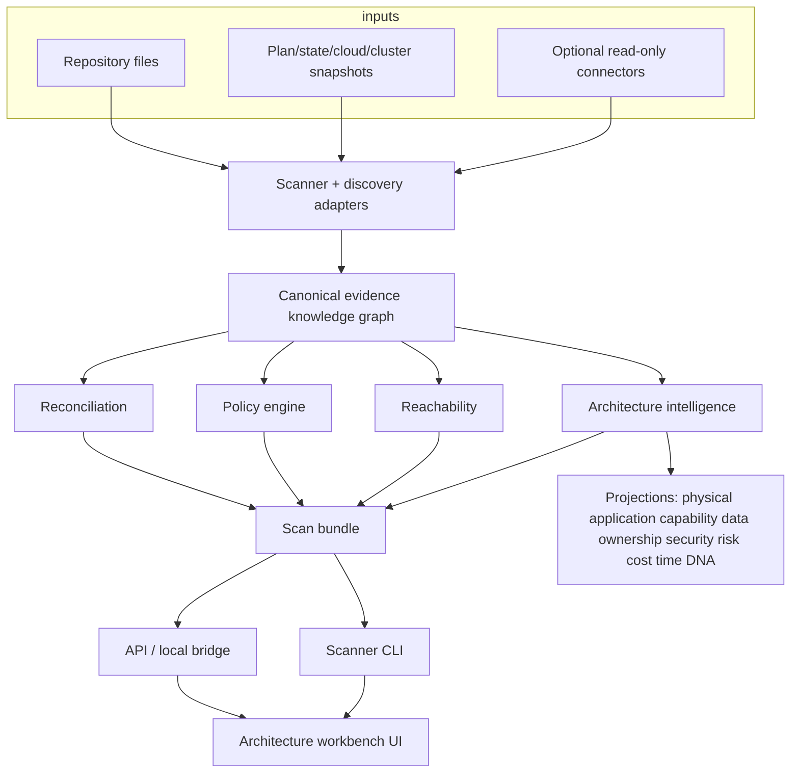

# Architecture

## Layers

1. **Discovery adapters** — Terraform, Kubernetes, OpenShift, app-config, AWS snapshot
2. **Canonical evidence graph** — resources, edges, evidence, findings, drift, completeness, semantic layers
3. **Architecture intelligence** — capability/data/ownership/trust inference, risk, health, DNA, story, missions, timeline, simulation
4. **Analysis** — reconciliation, policy, reachability, business blast radius
5. **Review engine** — staged reviews, personas, playbooks, recommendations, notebook, approval
6. **Delivery** — hashed scan bundle, CLI, API, review console UI

There is **one** evidence graph. Projections and reviews are derived. The primary UX is the review, not the graph.

The browser never becomes an unrestricted cloud client. Live connectors are credential-reference based, read-only, disabled by default, and snapshot-backed in this release.
