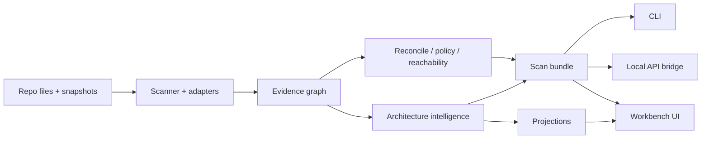

# System overview

InfraLens is a local-first **Architecture Governance** system: discovery adapters feed one canonical **evidence knowledge graph**; projections, reviews, and approvals are derived from that graph. Analysis is deterministic and does not require an LLM.

For a compact diagram and layer list, see also [overview.md](overview.md).

## End-to-end flow

1. **Discover** — Walk the project; adapters emit resources, relationships, evidence, warnings, unsupported constructs.
2. **Reconcile & analyse** — Merge truth layers; run policies and reachability; compute findings and drift.
3. **Govern** — Materialise intents, ADRs, assumptions, contracts; run review / recommendation logic.
4. **Deliver** — Persist a hashed bundle; serve CLI, optional API, and the React workbench.

## Runtime pieces

| Component | Location | Role |
|-----------|----------|------|
| Scanner core | `packages/scanner` | Orchestrates walk + adapters + enrichment |
| Discovery adapters | `packages/discovery-*` | Terraform, K8s, OpenShift, app-config, AWS snapshot |
| Graph model | `packages/graph-model` | Typed nodes, edges, bundle validation |
| Evidence model | `packages/evidence-model` | Evidence records, confidence, redaction |
| Policy engine | `packages/policy-engine` | Declarative YAML policies |
| Architecture intelligence | `packages/architecture-intelligence` | Projections, governance, review, simulation |
| Capability registry | `packages/edition-capabilities` | Runtime readiness (not licensing) |
| Scanner CLI | `apps/scanner-cli` | `scan`, `inspect`, `compare`, `report`, `capabilities` |
| API bridge | `apps/api` | Local in-memory / lightweight persistence |
| Workbench | `apps/web` | Governance console + projection canvas |

## Design invariants

1. **One graph** — Projections never invent a second store of truth.
2. **Evidence before inference** — Unknowns and conflicts remain first-class.
3. **Adapter isolation** — One failing adapter must not abort the scan.
4. **Local-first / safe defaults** — Live connectors off; credential references only; secret redaction before persistence.
5. **No edition gates** — Fully open source; `INFRALENS_FEATURE_*` are operational kill switches only ([migration note](../product/migration-from-editions.md)).

## Trust boundary

The browser is not an unrestricted cloud client. Hosted static demos, if published, must use bundled synthetic estates only ([hosted-demo.md](../demo/hosted-demo.md)). Scanner threat summary: [scanner-security.md](scanner-security.md).

## Preview scope

Persistence, portfolio governance, and large-graph performance are early. See [product/limitations.md](../product/limitations.md).
